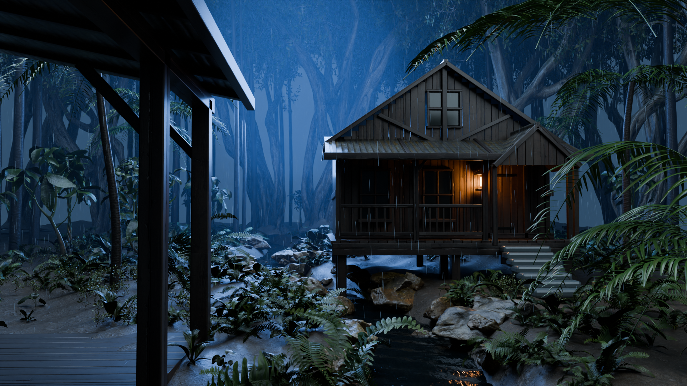

# Rainforest cabin — new scene

Independent Blender project based on the tropical rain cabin reference supplied
in chat. The canceled tavern project is not modified.

## Current clear-view still and motion test



1920×1080, up to 128 Cycles samples with adaptive sampling. The isolated central
palm and five bare trunks are relocated into the side forest. The camera and
porch framing remain fixed. Earlier stills remain in `renders/first_still.png`
and `renders/foliage_still.png`.

[Watch the four-second motion test](renders/motion/preview.mp4)
· [Placement, motion details and checks](research/tree-and-motion.md)

The motion test is silent, 640×360, native 24 fps / 96 frames. It checks falling
rain, gentle leaf sway/flex, creek movement, expanding ripples and eave runoff.
It is a preview, not final YouTube quality or a seamless loop. Current artifact
checks are `renders/qa_clear_view.json` and `renders/motion/qa.json`.

[Real-photograph reference board](research/forest_photographs/reference_board.jpg)
· [Photograph credits and licences](research/forest_photographs/CREDITS.md)
· [Neutral-light leaf comparison](renders/leaf_comparison.jpg)
· [Reference observations and implementation](research/foliage-study.md)

The previous JPEG glTF leaf textures had fully opaque alpha channels. The corrected
libraries use the provider's separate silhouette masks, including canopy masks.
Four understory assets now use 4K photographic maps. Wide paired palm strips have
been replaced with curved, staggered pinnae and varied droop. No reference
photographs are used as render textures.

## First milestone

Build and inspect a still from a sheltered timber porch looking across a rocky
stream at a raised wooden cabin. Foreground palms frame the view; tropical
undergrowth and mist separate the cabin from the forest. Cool storm illumination
is balanced against a small warm lantern. Match the reference composition before
attempting a long animation.

Reference details: dark porch at left, near post around the left third, overhanging
roof, pitched tiled cabin roof, front veranda, warm wall lantern, uneven stone
steps, sinuous shallow stream, wet rocks, ferns and large glossy palm fronds.
The reference is visible in chat; the attachment is not exposed as a local file.
Do not substitute the old tavern reference or claim a pixel-aligned comparison.

## Asset approach

Use publicly downloadable CC0 Poly Haven ferns, broadleaf plants, rocks, tree
geometry, 2K architectural/canopy maps and 4K understory leaf maps. The catalog contains no suitable complete palm or
matching cabin: build these as original detailed geometry. Source manifests,
checksums and credit links are retained alongside the project.

## Intended checks

Inspect composition, geometry contact, texture orientation, rain visibility,
water reflections, shadow detail and close foliage before the final still.
This milestone is a still, not an approved animation or finished YouTube video.

## Render and rebuild

Use Python 3.11 with `pip install -r requirements.txt`. No paid assets or logins
are required. `scripts/prepare_assets.py` fetches the original glTF sources and
2K/4K maps and separate alpha masks, verifies provider MD5 checksums and keeps the manifests. The supplied
Blender libraries already contain the scanned model geometry and packed maps.

From this project directory:

```sh
python scripts/prepare_assets.py
python scripts/build_asset_library.py
python scripts/render_supervised.py
python scripts/setup_motion.py
python scripts/check_motion_rig.py
python scripts/render_motion.py
python scripts/check_motion_visual.py
python scripts/check_delivery.py
python scripts/check_portability.py
```

The supervisor defaults to `renders/clear_view_still.png`, a 1920×1080, up-to-128-sample Cycles CPU still. For a quick
composition diagnostic, use `WIDTH=640 SAMPLES=24 OUTPUT=composition.png` before
the supervisor command. It writes `status.json` and `logs/render.log`. All output
is under this project. The final scene is `rainforest_cabin.blend`; download this
entire project folder to retain linked model libraries and architectural maps.

The render worker explicitly exits after the completed image write, bypassing
a known native bpy shutdown stall in this environment. It does not interrupt an
unfinished render. The supervisor marks success only after the completion marker
and a zero worker exit code.

## First still: realism limits and next milestone

This is an initial camera/material/lighting study. The cabin and palms use original
geometry; scanned assets provide detailed ferns, broadleaf plants, rocks and canopy.
The reference's very dark foreground, dense organic layering and irregular cabin
silhouette remain the comparison targets. Look for overly even timber/shingles,
repetitive palm leaflets, an unnaturally uniform forest and insufficient stream
turbulence. More samples cannot solve those geometry/material issues.

Rain streak geometry has independent recycling drivers. It is an optical exposure
approximation, not a fluid or droplet-collision simulation. Eave strands and ripple
rings in this still are static. Stream flow, splash timing, wind, rain wrap visibility
and temporal denoising require review in the short moving test. The first silent
motion diagnostic is supplied; no soundtrack or long video has been produced.
Do not describe this study as finished ultra realism.

Next review priorities: camera/framing and night mood first, then irregularity of
the timber/roof, foreground palm realism, stream detail and visible rainfall.
After those are satisfactory, animate rain, stream/runoff and restrained plant
movement and render a short test before producing a long YouTube sequence.
