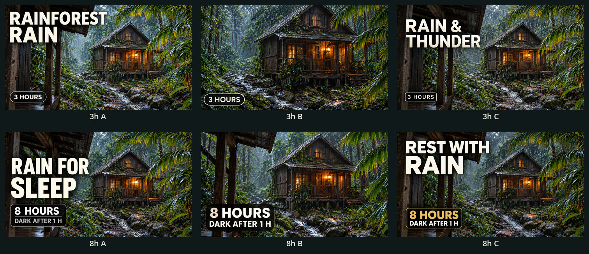

# Rainforest cabin — six YouTube thumbnails

[Download all six upload-ready JPGs](../../../downloads/Rainforest_YouTube_Thumbnails.zip)

Each upload file is **1280 × 720**, JPEG, under **2 MiB**. Choose a thumbnail
from the matching duration, or add all three matching files to YouTube Studio's
thumbnail Test & Compare feature if it is available for your channel.

| Version | Option | Design | Upload file |
| --- | --- | --- | --- |
| 3 hours | A | Wide scene, “Rainforest Rain” | [3h A](rainforest_3h_A.jpg) |
| 3 hours | B | Cabin close-up, duration badge, minimal text | [3h B](rainforest_3h_B.jpg) |
| 3 hours | C | Wide scene, “Rain & Thunder” | [3h C](rainforest_3h_C.jpg) |
| 8 hours | A | Wide scene, “Rain for Sleep” | [8h A](rainforest_8h_A.jpg) |
| 8 hours | B | Cabin close-up, minimal text | [8h B](rainforest_8h_B.jpg) |
| 8 hours | C | Wide scene, “Rest with Rain” | [8h C](rainforest_8h_C.jpg) |

All 8-hour covers state **DARK AFTER 1 H**. They do not imply a dark screen
throughout the whole video. None makes an ad-free claim or shows lightning,
people, animals or other subjects absent from the approved scene.

Suggested starting choices: **3h A** for clear subject identification and
**8h B** for the cabin atmosphere with an explicit dark-screen label. These are
editorial recommendations, not measured audience preferences. All three options
per duration are available for your own review or a thumbnail experiment.

[320-pixel readability review](small_size_review.jpg)
· [Approved scene versus thumbnail](source_comparison.jpg)
· [Checksums and provenance](manifest.json)

The thumbnails were made with image-generation edits of the approved scene,
followed by delivery sizing/JPEG encoding. They are illustrated cover edits,
not untouched video-frame exports. The source cabin composition, natural
rainforest mood and warm/cool lighting relationship guide the covers; close-up
options crop away the foreground shelter and emphasize the cabin. The covers
lift contrast and cabin visibility for small previews. The finished videos
remain unchanged. Generation originals are retained separately for review.

To download one image, open its link and use GitHub's **Download raw file**
button, or download the ZIP above. The ZIP contains only the six upload JPGs,
comparison sheets, this guide and the manifest. The original generation files
are not needed for YouTube upload.
